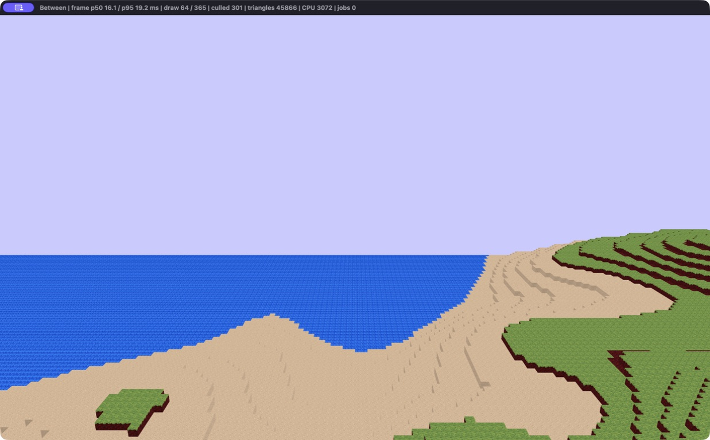

# Between

A voxel terrain engine built in Rust with wgpu and Slang shaders. It explores how procedural terrain moves from a density field through worker threads into compact GPU geometry.



## Run

Requires **Rust 1.94+** and **Slang 2026.5.2** (`slangc` on PATH). Download Slang for your platform from its [official release](https://github.com/shader-slang/slang/releases/tag/v2026.5.2); alternatively set `SLANGC=/absolute/path/to/slangc`. The build compiles the Slang sources to WGSL. No nightly compiler is needed.

```sh
cargo run --release --locked -- --seed 42 --view-distance 8 --vertical-distance 4
```

Chunk offsets use half-open ranges: `-distance..distance`. These settings select a 16 × 8 × 16 chunk region around the camera, with the vertical range following camera height. Smaller distances reduce the initial terrain region; `--view-distance 4 --vertical-distance 2` is a quick smoke run. Run with `RUST_LOG=info` to print the seed, settings, and GPU adapter.

| Control | Action |
| --- | --- |
| WASD / arrows, mouse | Free flight and look |
| Space / E, Ctrl / Q | Up, down |
| Left Shift | Sprint |
| P | Toggle wireframe (when supported by the GPU) |
| C | Toggle frustum culling for comparison |
| Escape | Quit |

The title bar reports frame-interval p50/p95 over the last second, submitted/resident chunk counts, culled chunks, triangles, and CPU chunks. Frame intervals include vsync and scheduling; they are not GPU timings.

## Engineering highlights

- **Terrain workers:** `WorldState` owns chunk storage, loading, and the queued/dirty sets; worker threads generate chunks and mesh immutable snapshots. Requests and results use unbounded channels.
- **GPU cache:** recently visible meshes are retained in an LRU with both a 2,048-entry cap and a 64 MiB payload budget.
- **Visibility:** neighbour-aware hidden-face removal plus conservative chunk-AABB frustum culling compatible with infinite reversed Z. Only resident nonempty GPU meshes are considered for drawing.
- **Compact data:** flat 4,096-byte voxel arrays, non-air occupancy masks, four-byte packed vertices, indexed triangles, texture arrays, and per-chunk block-volume textures.
- **Procedural terrain:** seeded layered noise and trilinear interpolation from a 5³ sampling grid into each 16³ chunk.
- **Validation:** independent meshing and clip-space culling oracles, loader and worker-pipeline tests, repeatable CPU benchmarks, and CI for formatting, Clippy, tests, and shader compilation.

In a historical capture made with the separate terrain scheduler, culling submitted **64 of 365** nonempty chunk meshes. This is a draw-count observation from that earlier implementation, not an FPS speedup or a measurement of the current implementation. See [performance and reproduction details](docs/performance.md).

[Architecture](docs/architecture.md) · [Application plan and interview notes](docs/application-plan.md) · [Wireframe screenshot](assets/showcase/wireframe.png)

## Verify

```sh
cargo fmt --all -- --check
cargo clippy --locked --all-targets -- -D warnings
cargo test --locked
cargo bench --locked --bench engine
```

The benchmark needs no window or GPU, but Slang is still required by the build. CPU tests and visual smoke checks were run on macOS 26.5.1, Apple M2 / Metal. The Linux GitHub Actions workflow is provided; a hosted CI run has not yet been observed.

## Scope and next experiments

This is an engine prototype with free flight. Meshing emits visible unit faces; it is not greedy meshing. Face lighting is a fixed artistic approximation. Water uses the opaque pass. Collision, block editing, persistence, transparent water, LOD, and shadows are not implemented. Generation is reproducible within the tested build; cross-platform bit-identical terrain is not guaranteed.

CPU chunks currently remain stored during travel. Scheduling and uploads have no per-frame budgets, and generation covers the render region without a neighbour halo, so stationary boundary chunks can remain unmeshed. These are limitations of the original `WorldState` update loop.

Next: record a short narrated flythrough, profile the same camera route in release mode, then evaluate greedy meshing or material IDs in vertices against this baseline. The [application plan](docs/application-plan.md) explains what to measure before making a resume claim.

Runtime images are embedded from `assets/game`; `assets/raw` holds editable source artwork. Log and leaf layers currently reuse placeholder textures.
